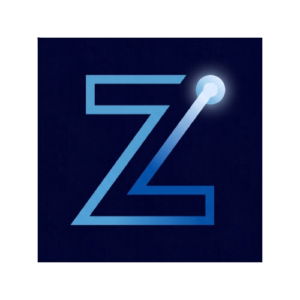

# 🪐 Zahit — Minimalist & Raw Astro v7 Portfolio Blog Theme

<div align="center">
  
  <p><em>"Simplicity is depth, not lack."</em></p>

  [](https://astro.build)
  [](https://mdxjs.com)
  [](https://github.com/kuscadev/Zahit)
  [](https://astro-zahit.netlify.app)
  [](https://nodejs.org)
  [](LICENSE)
</div>

---


**Zahit** is a raw, flat minimalist **Astro v7** portfolio & blog theme built on the philosophy that simplicity is depth. Stripping away unnecessary widgets, heavy frameworks, and digital clutter, Zahit closes the gap between the writer and the reader, presenting a clean, content-first canvas optimized for developers, system administrators, and thinkers.

The theme features a cohesive, premium dark design system using a deep space blue background (`#00022b`), highlighted by vibrant ice-blue accents (`#4fa5d8`) and optimized ice-blue tinted text (`#daeaff`) for exceptional high-contrast reading comfort.

🔗 **Live Demo:** [https://astro-zahit.netlify.app](https://astro-zahit.netlify.app)

---

## 🚀 Core Features

Despite its ultra-minimalist appearance, Zahit is packed with highly refined, modern engineering features:

### 🌐 1. Advanced i18n & Smart Translation Mapping
* **Bilingual Routing:** Built-in internationalization (i18n) support for Turkish (`tr` as default) and English (`en` as secondary). Using Astro's localized routing rules with `prefixDefaultLocale: false` means Turkish resides at the root `/` path, and English pages are served under `/en/`.
* **Smart Post Redirects:** The language switcher in [`Header.astro`](src/components/Header.astro) is dynamically mapped. If you are reading a localized blog post and click the language switcher, it looks up the corresponding translated post in the other language using a shared `translationKey` frontmatter value (e.g., `/tr/blog/kodun-estetigi/` redirects straight to `/en/blog/aesthetics-of-code/`). If no translation exists, it gracefully redirects to the target language's `/archive/` page.

### 📅 2. Dynamic Year-Grouped Archive
* **Year-Based Grouping:** Posts on the [`archive.astro`](src/pages/%5Blang%5D/archive.astro) page are dynamically grouped by their publication year (`2026`, `2025`, etc.) on compile time.
* **Fluid Hover Interactions:** Features smooth minimalist transitions where links slide slightly to the right (`translateX`) on hover for an interactive, modern look.

### 📑 3. ScrollSpy-Enabled Dynamic Table of Contents (ToC)
* **Heading Scanner:** The [`BlogPost.astro`](src/layouts/BlogPost.astro) layout dynamically parses `h2` and `h3` heading elements inside your MDX file.
* **Active State Tracker:** A native, lightweight scroll-event listener tracks the reader's viewport scrolling location, dynamically applying an `.active` class to the current section inside the sticky Table of Contents sidebar.

### 📋 4. One-Click Code Clipboard Copier
* **Hover Copy Button:** A copy button seamlessly overlays code blocks (`pre`) on hover.
* **Visual Confirmation:** Tapping the copy button instantly copies the code block to the user's clipboard and switches icons to an animated confirmation checkmark with a transient highlight, resetting back after 2 seconds.

### 📱 5. Responsive Profile Sidebar
* **Sticky Layout:** The profile panel floats as a sticky sidebar on large desktop monitors, keeping author details and social links readily available.
* **Mobile-Optimized Layout:** Under `860px` screen widths, the author's avatar is automatically hidden via CSS media queries (`@media (max-width: 859px) { .avatar { display: none; } }`) to conserve vertical space and eliminate mobile distractions.

### 🔗 6. External Blog Posts Support
* **Direct External Linking:** Seamlessly link to external articles (Medium, Substack, personal blogs, etc.) by specifying `external_url` and optional `external_source` in the post's frontmatter.
* **Minimalist UI Indicators:** Post listings automatically display a subtle external icon (`↗`), open securely in a new tab (`target="_blank"` with `rel="noopener noreferrer"`), and show a clean source badge next to the date.
* **Seamless Ecosystem Integration:** Direct visits to the local post route are automatically 301-redirected to the destination URL, and RSS feeds emit the external URL directly.

---

## 🛠️ Tech Stack

* **Astro v7.0+** — Modern, component-based static site generator powered by the Rust compiler, Vite 8, and zero client-side JS by default.
* **MDX Integration** — Markdown extension that allows importing interactive components and structures inside posts.
* **Astro-Icon** — Highly optimized SVG icon wrapper supporting Iconify icon packs.
* **Pure CSS Design System** — Built purely on top of local CSS variables (`global.css`) without bloated utility frameworks.

---

## 📁 Repository Structure

```text
Zahit/
├── public/                     # Static assets (favicons, profile graphics)
│   ├── favicon.svg             # The vector logo used across the site
│   └── profile.jpeg            # Desktop sidebar avatar picture
├── src/
│   ├── components/             # Reusable Astro UI components
│   │   ├── BaseHead.astro      # Site meta tags, SEO setup, and font loaders
│   │   ├── Footer.astro        # Minimal footer links
│   │   ├── Header.astro        # Header layout, logo, and smart i18n switcher
│   │   └── Profile.astro       # Author info and social link matrix
│   ├── layouts/                # Page shell layouts
│   │   ├── BaseLayout.astro    # Core HTML viewport shell
│   │   └── BlogPost.astro      # Blog layout with ToC, ScrollSpy, and Clipboard Copy
│   ├── i18n/                   # Translation configuration
│   │   ├── ui.ts               # Localized translation dictionary keys
│   │   └── utils.ts            # Translation route parsers and slug resolvers
│   ├── pages/                  # Page routes (File-based Routing)
│   │   ├── [...lang]/          # Localized routes (Home, Archive, Tags, RSS)
│   │   │   ├── blog/
│   │   │   │   └── [...slug].astro  # Dynamic blog posts resolver & 301 redirect
│   │   │   ├── tags/           # Tag indices and filtered posts
│   │   │   ├── about.astro     # Localized About page
│   │   │   ├── archive.astro   # Year-grouped archive
│   │   │   ├── index.astro     # Localized Home page
│   │   │   └── rss.xml.ts      # Localized RSS feed
│   │   └── 404.astro           # 404 fallback page
│   ├── styles/                 # Styling architecture
│   │   └── global.css          # Color scheme tokens, resets, & typography
│   ├── content/                # Content directories
│   │   └── blog/
│   │       ├── en/             # English posts (.mdx / .md)
│   │       └── tr/             # Turkish posts (.mdx / .md)
│   ├── content.config.ts       # Astro collections schema schema definitions
│   └── config.ts               # Core site variables, bio, and social listings
├── astro.config.mjs            # Astro configuration with MDX and i18n routing
├── package.json                # Project dependencies and operational scripts
└── tsconfig.json               # TypeScript definitions
```

---

## ⚡ Getting Started

Run Zahit locally in just a few steps. Make sure you have **Node.js >= 22.12.0** installed on your system.

**1. Clone the repository:**
```bash
git clone https://github.com/kuscadev/Zahit.git
cd Zahit
```

**2. Install dependencies:**
```bash
npm install
```

**3. Run the local development server:**
```bash
npm run dev
```
Open [http://localhost:4321](http://localhost:4321) in your browser to preview your site.

**4. Build for production:**
```bash
npm run build
```
The optimized static build outputs to the `./dist/` directory, ready to be deployed to Netlify, Vercel, or GitHub Pages.

**5. Preview your build locally:**
```bash
npm run preview
```

---

## ⚙️ Configuration & Customization Guide

Make Zahit your own by customizing these key configuration scopes:

### 👤 1. Set Your Bio & Socials: `src/config.ts`

Personalize the site metadata, biography, avatar, and social links in [`src/config.ts`](src/config.ts):

```typescript
export const SITE_CONFIG = {
  title: 'Zahit',
  description: 'A raw, flat minimalist theme built on the philosophy that simplicity is depth.',
  url: 'https://zahit.dev',
};

export const AUTHOR = {
  name: 'John Doe',
  role: {
    tr: 'Yazar | Geliştirici | Düşünür',
    en: 'Writer | Developer | Thinker',
  },
  bio: {
    tr: 'Teknik konuları sade bir dille anlatan bağımsız bir yazarım. Projelerimi ve düşüncelerimi burada paylaşıyorum.',
    en: 'An independent writer who explains technical topics in plain language. I share my projects and thoughts here.',
  },
  avatar: '/profile.jpg', // Place your avatar in the /src/assets folder
};

export const SOCIALS = [
  { label: 'Mail', href: 'mailto:johndoe@example.com', icon: 'mdi:email' },
  { label: 'GitHub', href: 'https://github.com/johndoe', icon: 'mdi:github' },
  // Add additional channels by mimicking this schema
];
```

*Note: Icons are imported via the [Iconify Material Design Icons (MDI)](https://icon-sets.iconify.design/mdi/) set.*

---

### ✍️ 2. Writing Linked Bilingual Blog Posts

To leverage Zahit's bilingual matching feature, place the post files in the respective locale directories and bind them together with a matching `translationKey`:

1. **Add your files under the content directory:**
   * Turkish draft: `src/content/blog/tr/sadelik.mdx`
   * English draft: `src/content/blog/en/simplicity.mdx`

2. **Specify matching `translationKey` parameters in both frontmatters:**
   Provide the exact same key in both files so the smart language switcher in the header knows they are translated versions of each other.

#### Turkish Post Frontmatter Example (`src/content/blog/tr/sadelik.mdx`):
```markdown
---
title: 'Sadelik, Eksiklik Değil Derinliktir'
description: 'Minimalizmin anlamı ve Zahit temasının temel felsefesi.'
pubDate: '2026-05-16'
tags: ['minimalizm', 'tasarim', 'felsefe']
translationKey: 'simplicity-post' # MUST match the English post key exactly
---

Türkçe içeriğinizi buraya yazın...
```

#### English Post Frontmatter Example (`src/content/blog/en/simplicity.mdx`):
```markdown
---
title: 'Simplicity is Depth, Not Lack'
description: 'Discover the meaning of minimalism, the core philosophy of the Zahit theme.'
pubDate: '2026-05-16'
tags: ['minimalism', 'design', 'philosophy']
translationKey: 'simplicity-post' # MUST match the Turkish post key exactly
---

Write your English content here...
```

---

### 🔗 3. Writing External Blog Posts

To feature an article published on an external platform (e.g. Medium, Substack, dev.to) alongside your local posts, simply include `external_url` and optional `external_source` in the post's frontmatter:

```markdown
---
title: 'Modern Web Development Approaches'
description: 'An in-depth article published on an external platform.'
pubDate: '2026-06-01'
tags: ['web', 'architecture']
external_url: 'https://medium.com/@username/modern-web-development'
external_source: 'Medium' # Optional: renders a badge next to the date
---
```

* **Listing Cards:** Automatically navigate directly to the target URL in a new tab (`target="_blank" rel="noopener noreferrer"`), accompanied by a minimal `↗` indicator and source badge.
* **Fallback 301 Redirect:** If a user accesses the local post slug directly, they are seamlessly redirected with an HTTP 301 status.
* **RSS Feed:** The RSS feed item's `link` automatically references the external URL.

---

### 🎨 4. Customize Colors & Themes: `src/styles/global.css`

Zahit is entirely customized using CSS variables. Change the theme colors, typography, or grid width in [`src/styles/global.css`](src/styles/global.css):

```css
:root {
  /* Color Palette Variables */
  --bg-color: #00022b;     /* Deep Space Blue Background */
  --dark: #010e54;         /* Section dark accenting blocks */
  --accent: #0855b1;       /* Primary accent color (Links, borders) */
  --light: #4fa5d8;        /* Brighter accent blue for hovering states */
  --text-color: #daeaff;   /* Soft ice-blue text tint for superior reading readability */

  /* Typography Variables */
  --font-family-body: 'Source Sans 3', sans-serif;
  --font-family-heading: 'Source Sans 3', sans-serif;

  /* Global Widths */
  --site-width: 80%;       /* Global responsive container width */
  --content-padding: 2rem;
  
  /* Transition timings */
  --transition-speed: 0.2s;
}
```

---

### 🗣️ 5. Edit Menu Labels: `src/i18n/ui.ts`

Customize translation dictionary labels or add extra languages in [`src/i18n/ui.ts`](src/i18n/ui.ts):

```typescript
export const languages = {
  tr: 'Türkçe',
  en: 'English',
};

export const defaultLang = 'tr';

export const ui = {
  tr: {
    'nav.home': 'Ana Sayfa',
    'nav.about': 'Hakkında',
    'nav.archive': 'Arşiv',
    'toc.title': 'İçindekiler',
    // ...other TR definitions
  },
  en: {
    'nav.home': 'Home',
    'nav.about': 'About',
    'nav.archive': 'Archive',
    'toc.title': 'Contents',
    // ...other EN definitions
  },
} as const;
```

---

## 📜 License

This project is open-source and licensed under the [MIT License](LICENSE).

---

<div align="center">
  <p><em>Minimal. Practical. Worth Sharing.</em></p>
  <p>Developed with passion by <strong><a href="https://github.com/kuscadev">kuscadev</a></strong></p>
</div>
